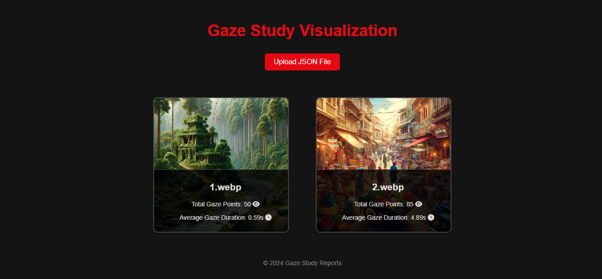

# GazingStudy – Webcam Eye-Tracking Study for Autism Research

GazingStudy is a browser-based eye-tracking study that uses an ordinary laptop webcam to record where a person looks on a series of images. I built it in 2024 as a biomedical engineering project, to explore low-cost ways of studying visual attention, such as how people look at social and everyday scenes, which is an active area of autism research.

No eye-tracking hardware is needed, and webcam video never leaves the computer. All processing happens in the browser.

> **Disclaimer:** This is a research and educational project. It is **not** a medical device and must **not** be used to diagnose autism or any other condition.



## How the study works

1. **Start page:** an overview of the three stages (calibration, study, results).
2. **Calibration:** the participant looks at each of 9 dots and clicks it 5 times until it turns yellow. This trains WebGazer's gaze model for that person.
3. **Accuracy check:** the participant stares at the centre dot for 5 seconds and the tool shows an accuracy score (0–100%, based on how close the predictions land to the dot).
4. **Study:** after entering a participant ID, 39 images are shown in sequence. Most are on a timer (8–25 seconds); some stay until skipped. There is a progress bar, plus pause, skip and end controls.
5. **Download:** the gaze data is saved as `gaze_data.json`, with every gaze point tied to the image it was recorded on.
6. **Results:** upload the JSON file to see the gaze path drawn over every image, the number of gaze points and the viewing time, and download a PDF report for each image.

## Run it locally

A local web server is needed, because browsers block webcam access for pages opened straight from a file.

```bash
git clone https://github.com/Yuvarajv2708/GazingStudy.git
cd GazingStudy
python3 -m http.server 8000
```

Then open **http://localhost:8000** in Chrome or Edge and allow camera access. An internet connection is needed the first time, because WebGazer downloads its face-detection model.

Tips for better accuracy: sit about an arm's length from the screen, use good front lighting, and keep your head still.

## Data format

Each record in `gaze_data.json` looks like this:

```json
{
  "imagePath": "assets/1.webp",
  "gazePoint": { "x": 512.4, "y": 300.8 },
  "timestamp": 15234.5,
  "subjectName": "P01"
}
```

`x` and `y` are in pixels relative to the image's top-left corner, and `timestamp` is in milliseconds since tracking started. Only gaze points that fall on the image are saved.

**Privacy:** use participant IDs (like `P01`) rather than real names, and never commit real participant data to this repository.

## Project structure

```
├── index.html            # Start page
├── calibration.html      # 9-point calibration + accuracy check
├── study.html            # Image sequence and gaze recording
├── Results.html          # Upload gaze data, view gaze paths, export PDF
├── assets/               # Study images (AI-generated)
├── css/                  # Styles
├── js/
│   ├── calibration.js            # Calibration and accuracy flow
│   ├── main.js                   # Starts WebGazer
│   ├── precision_calculation.js  # Accuracy score
│   ├── precision_store_points.js
│   ├── resize_canvas.js
│   ├── intro.js                  # Start page
│   └── script.js                 # Results page
├── webgazer.js           # WebGazer.js library (Brown HCI, GPLv3)
├── html2pdf.bundle.min.js
└── node_modules/         # Bootstrap and SweetAlert (UI)
```

## Limitations

- Webcam eye tracking is much less precise than dedicated eye trackers. Expect errors of several centimetres on screen, especially with poor lighting or head movement.
- The tool records raw gaze points. It does not detect fixations or saccades.
- The accuracy score is a simple 0–100% measure, not the standard degrees of visual angle.

## Built with

- [WebGazer.js](https://webgazer.cs.brown.edu) – webcam eye tracking (Brown University HCI Group)
- html2pdf.js, Bootstrap, SweetAlert

## License

GNU General Public License v3.0 (see [LICENSE](LICENSE)), the same license as WebGazer.js. You can use, modify and share this project, as long as you keep the credit to the original author and release your changes under the same license.

## How to credit

If you use or build on this project, please credit:

> Yuvaraj V, *GazingStudy: Webcam Eye-Tracking Study for Autism Research*, 2024. https://github.com/Yuvarajv2708/GazingStudy

GitHub's **"Cite this repository"** button gives a ready-made citation. Please also cite WebGazer:

> A. Papoutsaki, P. Sangkloy, J. Laskey, N. Daskalova, J. Huang, J. Hays. *WebGazer: Scalable Webcam Eye Tracking Using User Interactions.* IJCAI 2016.

## Author

**Yuvaraj V** – Biomedical Engineer · [LinkedIn](https://www.linkedin.com/in/yuvaraj-v-99a445225)
